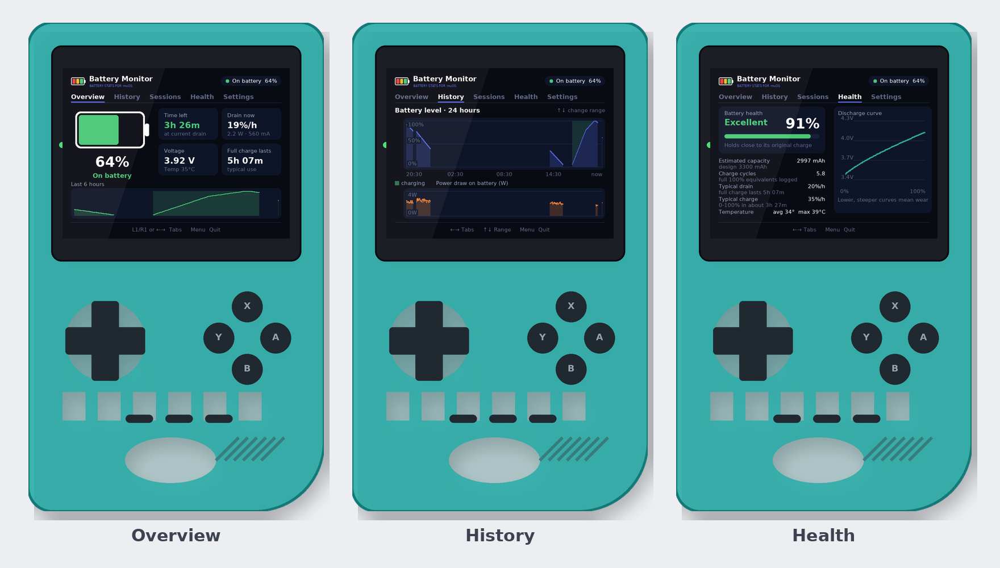
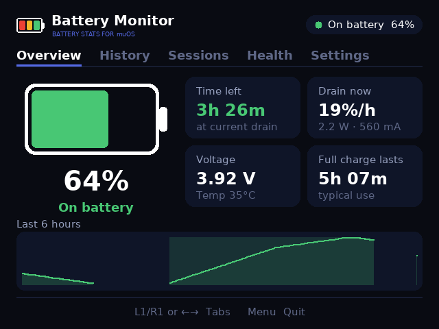
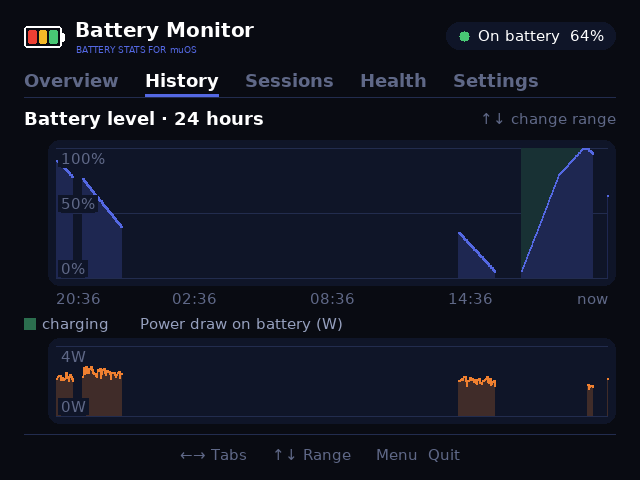
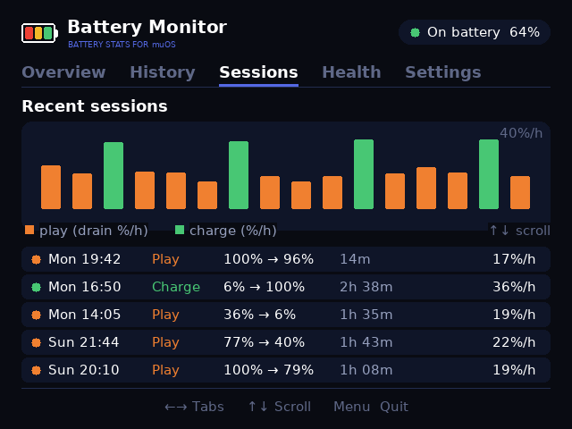
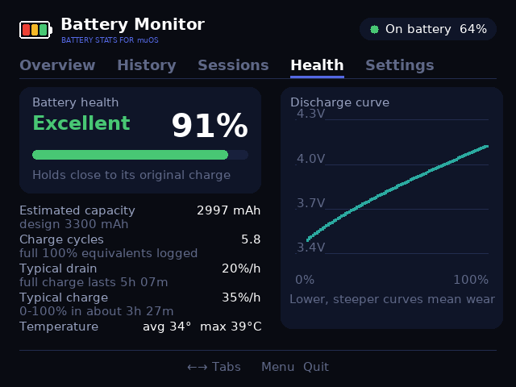
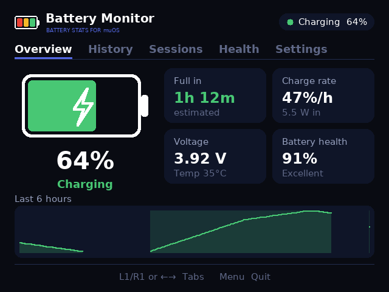
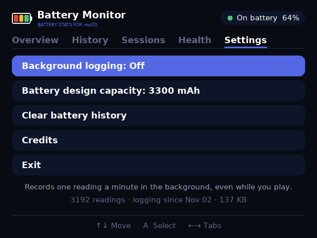

# Battery Monitor for muOS

**Battery life, drain and charge rates, graphs and health analytics for your muOS handheld.**

Battery Monitor shows how much play time you have left, how fast the battery is draining or charging, how your battery level has changed over the last hours and days, and how healthy the battery is compared with when it was new.



## Features

| Tab | What it shows |
|---|---|
| **Overview** | Charge level, **time left** (or **time to full** while charging), drain/charge rate in %/hour, watts and mA, voltage, temperature, battery health and a graph of the last 6 hours |
| **History** | Battery level graph for **6 h / 24 h / 3 days / 7 days**, charging periods shaded, plus power draw (or temperature) over the same period |
| **Sessions** | Every play and charge session: when, how long, % at start and end, and speed — with a bar chart to compare them |
| **Health** | Health grade and %, **estimated real capacity vs. design capacity**, charge cycles, typical drain and charge speed, full-charge run time, temperatures, and the voltage discharge curve |
| **Settings** | Background logging, battery design capacity, clear history, credits |

| Overview | History | Sessions |
|---|---|---|
|  |  |  |

| Health | Charging | Settings |
|---|---|---|
|  |  |  |

- **Background logging** — an optional tiny shell logger records one reading a minute, even while you play, so the app learns from your real use
- **No dependencies** — pure Python 3 standard library; runs on stock muOS
- **Fast start-up** — UI assets ship pre-decoded and history loads in the background during the intro
- Animated intro, battery logo and credits screen, styled to match [Collection Art](https://github.com/CryptoCaleb/muos-collection-art)

*Screenshots show a simulated week of battery data.*

## Requirements

- A handheld running **muOS** (MustardOS). Built for the **Anbernic RG35XX Pro** (640×480); other 640×480 muOS devices should work as-is.
- A battery driver that exposes `/sys/class/power_supply/<battery>/capacity` (all supported Anbernic H700 devices do). Voltage, current and temperature are used when available.

## Installation

1. Download **`BatteryMonitor.zip`** from [Releases](../../releases) and unzip it (or clone this repo).
2. Copy the **`BatteryMonitor`** folder into **`MUOS/application/`** on your SD card:
   ```
   MUOS/
   └── application/
       └── BatteryMonitor/
           ├── mux_launch.sh
           ├── app.py
           ├── batt.py
           ├── ui.py
           ├── logger.sh
           └── ...
   ```
3. On the device open **Applications → Battery**.

### Turn on background logging (recommended)

1. In the app go to **Settings → Background logging** and press A to turn it **On**. This adds `MUOS/init/batterymonitor_log.sh` to SD1 and starts logging straight away.
2. In muOS enable **Configuration → Advanced Settings → User Init Scripts** so logging restarts on every boot.

Without background logging the app only records while it is open. History is stored in `BatteryMonitor/data/battery.csv` and trimmed to roughly six weeks.

## Controls

| Button | Action |
|---|---|
| L1 / R1 or D-pad Left / Right | Switch tabs |
| D-pad Up / Down | Change graph range (History), scroll (Sessions), move (Settings) |
| A / any face button | Select (Settings) |
| Menu / Select | Quit |

## How the numbers are calculated

- **Drain now / time left** — uses the battery's measured current draw (averaged over the last 5 minutes) when the driver reports it, otherwise the trend of the last hour. Time left = current % ÷ drain rate.
- **Charge rate / time to full** — the slope of the last 20 minutes of charging; charging is assumed to slow to half speed above 80%, as lithium batteries do.
- **Sessions** — continuous stretches of discharging or charging (a gap of more than 15 minutes means the device was off or asleep).
- **Estimated capacity & health** — during every play session of 10% or more, the app adds up the current that flowed out of the battery (coulomb counting) and divides by the % used. The median of those estimates is compared with the design capacity (3300 mAh on the RG35XX Pro — adjustable in Settings). If the driver reports `charge_full`, that is used instead.
- **Charge cycles** — total % discharged ÷ 100.
- **Discharge curve** — voltage plotted against charge level; a lower, steeper curve indicates wear.

Estimates improve with more logged sessions; the Health tab shows **Learning** until it has enough data.

## Project layout

```
BatteryMonitor/
├── mux_launch.sh   # muOS application launcher
├── mux_lang.ini    # display names
├── app.py          # screens, charts, input handling
├── batt.py         # battery reading, log format, analytics
├── ui.py           # display backends (SDL2 via ctypes, /dev/fb0 fallback), input, drawing, text
├── logger.sh       # background logger (one sample per minute)
├── assets/         # font atlas and logos (.bin = pre-decoded, .png = source)
└── glyph/          # launcher icon (recoloured by your theme)
tools/
└── make_assets.py  # regenerates the assets (needs Pillow, run on a PC)
```

### Testing without a device

`batt.py` reads `$BATTMON_SYSFS` instead of `/sys/class/power_supply` when set, and `logger.sh` honours `BATTMON_SYSFS` and `BATTMON_INTERVAL`, so you can point both at a fake battery folder on a PC.

## Troubleshooting

- **"No battery found" or "--" values** — open `BatteryMonitor/last_run.log`; it lists the battery path and every value the driver reports. Please include it in an issue.
- **The % differs slightly from muOS's top bar** — Battery Monitor shows the % reported by the battery hardware; muOS can apply its own voltage-based curve.
- **Nothing is logged in the background** — make sure *User Init Scripts* is enabled and *Background logging* shows On.
- **Buttons don't respond as expected** — button codes vary by device; open an issue with your model.

## Credits

Created by **Caleb Hinton**. Built with Claude.

Thanks to the [MustardOS](https://muos.dev) team for muOS.

## License

[MIT](LICENSE)
